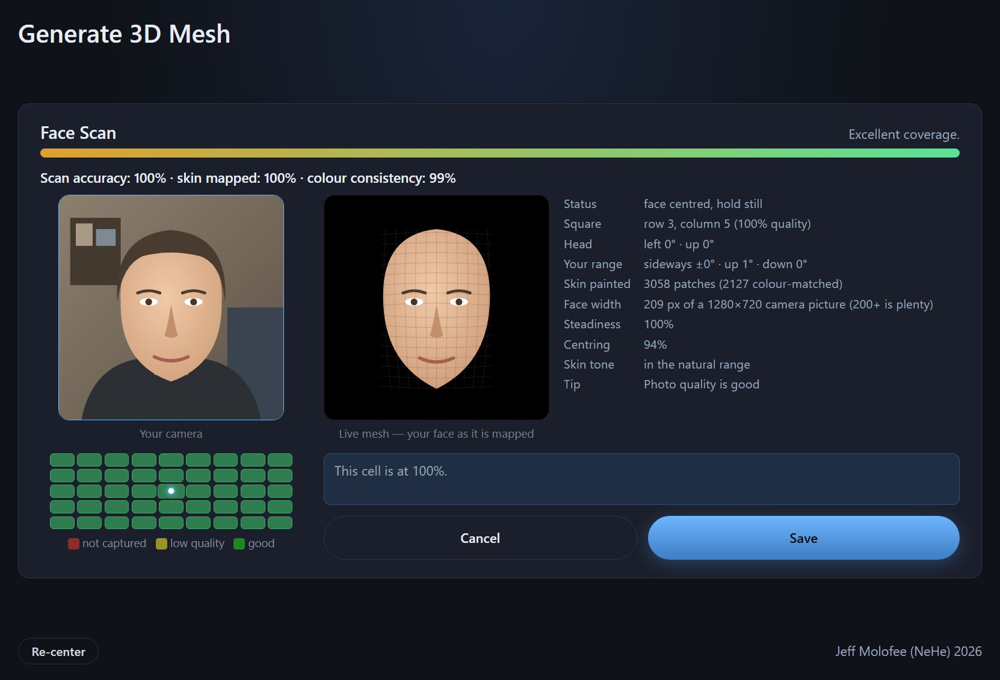

# Generate 3D Face Mesh

**2026 Jeff Molofee (NeHe)**

A small local app that builds a 3D mesh of your face from your webcam, and exports it as an OBJ model. Everything runs on your machine: no cloud, no account, no internet needed.

<p align="center">
  
</p>

## How it works

Look at the camera and move your head slowly around. The page tracks your face in the browser (MediaPipe, bundled) and keeps the best photo for each head angle. A grid shows which angles are covered, and a live mesh preview shows your face as it is mapped. When coverage is good, **Save** blends the photos into one seamless skin texture. **Export 3D model** then writes an OBJ model that uses it.

## Features

- Live face tracking with a pose-coverage grid
- Best photo kept for each head angle
- Live mesh preview with scan accuracy, skin-mapped and colour-consistency stats
- Seamless blended skin texture
- OBJ export (`mesh.obj`, `mesh.mtl`, `skin.png`)
- In-app 3D viewer
- Separate profile for each person

## Running it

**Release (Windows):** download the zip from [Releases](../../releases), extract it and run `Generate 3D Face Mesh.exe`. No installation required.

**From source (Windows):** double-click `Start Generate 3D Mesh App.bat` (own window) or `Start Generate 3D Mesh Web.bat` (browser tab). The first run creates a Python environment and installs the few packages in `requirements.txt` (needs Python 3.10+).

**Manual install (any platform):**
```bash
pip install -r requirements.txt
python run.py          # own window
python run.py web      # browser tab
```

The app listens on `http://localhost:8780`.

## Where your scans go

Everything for a person goes in `output/<name>/` (next to the .exe when using the release). The folder is the lowercase name: Jeff Molofee → `jeff_molofee`. Saving a scan builds the whole `mesh/` folder automatically.

| File | Description |
|---|---|
| `profile.json` | the name as typed |
| `photos/` | the best photo for each pose, with `photos.json` (measured head angle for each) |
| `mesh/mesh.obj`, `mesh.mtl`, `skin.png` | the 3D model and its skin texture: everything a 3D tool needs |
| `mesh/mesh.json` | the same mesh as plain data, used by the in-app viewer |
| `mesh/skin_atlas.json`, `preview.jpg` | the layout the model is built from, and a small picture of the skin |

## Project Structure

| File | Description |
|---|---|
| `run.py` | starts the local server and opens the window |
| `app/` | the server: scan saving, skin blending and OBJ export |
| `static/` | the web page: scan screen, face tracking and 3D viewer (MediaPipe bundled) |
| `Start Generate 3D Mesh App.bat` / `Web.bat` | Windows launchers (set up `.venv` on first run) |
| `requirements.txt` | Python dependencies |
